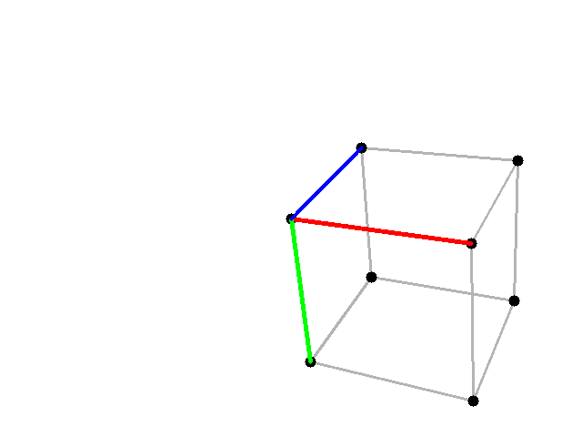

# Pinhole Camera Projection

A 3D computer vision project demonstrating **3D-to-2D perspective projection** using the pinhole camera model, Python, NumPy, and OpenCV.

The project visualizes a complete 3D unit cube, its projected vertices, and coordinate axes using a virtual camera with defined intrinsic and extrinsic parameters.

## Overview

The project implements a basic pinhole camera projection pipeline:

1. Define a 3D scene containing the vertices of a unit cube.
2. Configure the camera's intrinsic and extrinsic parameters.
3. Project the 3D vertices onto a 2D image plane.
4. Visualize the cube edges, vertices, and coordinate axes.
5. Save the resulting image to the `output/` directory.

### Projection Pipeline

```text
3D Points
    |
    v
Camera Extrinsics
(Rotation + Translation)
    |
    v
Camera Coordinates
    |
    v
Perspective Projection
    |
    v
Camera Intrinsics
    |
    v
2D Image Coordinates
    |
    v
Visualization
```

## Pinhole Camera Model

The pinhole camera model describes how a 3D point is projected onto a 2D image plane.

For a point in camera coordinates `(X, Y, Z)`, the ideal perspective projection is:

```text
u = fx * X / Z + cx
v = fy * Y / Z + cy
```

Where:
- `u`, `v` — projected pixel coordinates.
- `X`, `Y`, `Z` — 3D coordinates in the camera coordinate system.
- `fx`, `fy` — focal lengths in pixels.
- `cx`, `cy` — principal point coordinates.

OpenCV's `cv2.projectPoints()` performs the projection using the specified camera parameters.

## Camera Configuration

The camera intrinsic matrix is defined as:

```text
K = [ fx   0   cx ]
    [  0  fy   cy ]
    [  0   0    1 ]
```

The project uses the following illustrative camera parameters:

| Parameter | Value |
|---|---:|
| Image width | 640 px |
| Image height | 480 px |
| Focal length X (`FX`) | 800 |
| Focal length Y (`FY`) | 800 |
| Principal point X (`CX`) | 320 |
| Principal point Y (`CY`) | 240 |

The camera's extrinsic parameters define its rotation and translation relative to the 3D scene.

These values are configured in `main.py` and can be modified to experiment with different projections.

## 3D Scene

The scene contains eight vertices representing a unit cube.

The first four vertices define the origin and the three coordinate axes:

| Vertex | Coordinates | Description |
|---|---|---|
| 0 | `(0, 0, 0)` | Origin |
| 1 | `(1, 0, 0)` | X-axis |
| 2 | `(0, 1, 0)` | Y-axis |
| 3 | `(0, 0, 1)` | Z-axis |

The remaining vertices complete the cube.

All eight vertices are projected into image coordinates, and the twelve edges are drawn to visualize the complete 3D structure.

## Visualization

The projected vertices, cube edges, and coordinate axes are rendered on a white `640 × 480` image.

- **Gray lines:** unit cube edges.
- **Red line:** X-axis.
- **Green line:** Y-axis.
- **Blue line:** Z-axis.
- **Black points:** projected cube vertices.

## Result



The output image shows the projected unit cube, including all twelve edges, eight vertices, and three color-coded coordinate axes.

## Project Structure

```text
day1_pinhole/
├── main.py
├── output/
│   └── result.png
├── README.md
└── requirements.txt
```

- **`main.py`** — defines the 3D scene, configures the camera, performs the projection, renders the visualization, and saves the output.
- **`output/result.png`** — generated projection image.
- **`requirements.txt`** — Python dependencies required to run the project.
- **`README.md`** — project documentation.

The `output/` directory and the result image are generated automatically when the script runs.

## Installation

### 1. Clone the repository

```bash
git clone https://github.com/zhexe-design/computer-vision-edu.git
cd computer-vision-edu/week1_camera_models/day1_pinhole
```

### 2. Install dependencies

```bash
python -m pip install -r requirements.txt
```

The `requirements.txt` file contains:

```text
numpy>=1.24
opencv-python>=4.8
```

## Usage

Run the script from the `day1_pinhole` directory:

```bash
python main.py
```

The script will:
1. Project the 3D cube vertices into 2D image coordinates.
2. Draw the cube edges, vertices, and coordinate axes.
3. Save the resulting image to `output/result.png`.
4. Display the visualization in an OpenCV window.

Expected console output:

```text
Projection completed successfully!
Projected vertices: 8
Cube edges: 12
Image resolution: 640x480
Result saved to: <project_path>/output/result.png
```

Press any key while the OpenCV window is active to close it.

## Key Concepts

- Pinhole camera model and perspective projection.
- Camera intrinsic and extrinsic parameters.
- 3D-to-2D coordinate transformation.
- Camera rotation and translation.
- Visualization of projected 3D geometry using OpenCV.

## License

This project is intended for educational purposes.