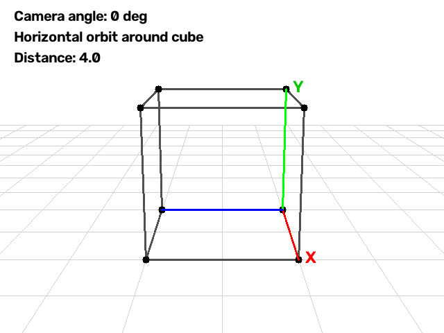

# Day 2 — Camera Orbit Control

Horizontal orbit of a virtual camera around a unit cube using a **look-at** transform (OpenCV + NumPy).

The camera moves on a circle in a fixed-height plane and always looks at the cube center. Frames are saved as an animated GIF.

## Result



An optional MP4 demo may also be available as `orbit.mp4`.

## What this demonstrates

- Camera extrinsics via look-at (position → `rvec`, `tvec`)
- Horizontal orbit with constant distance to target
- 3D → 2D projection of the cube and ground grid in each frame
- Simple animation export (GIF)

## How the orbit works

```text
Camera position (circle in XZ plane, fixed Y)
        │
        ▼
look-at(target = cube center)
        │
        ▼
rvec, tvec
        │
        ▼
projectPoints(cube + grid)
        │
        ▼
draw frame → collect → GIF
```

## Key parameters

```python
TARGET = [0.5, 0.5, 0.5]   # Cube center
CAMERA_DISTANCE = 4.0
CAMERA_HEIGHT = 1.5
# Horizontal orbit radius is derived so the distance to the target stays constant.
```

## How to run

```bash
cd week1_camera_models/day2_camera_control

python -m venv venv

# Windows:
venv\Scripts\activate

# macOS/Linux:
source venv/bin/activate

pip install -r requirements.txt
python main.py
```

- **Live preview:** an OpenCV window displays the orbit; press `Esc` to stop early.
- **GIF output:** `output/orbit.gif`
- **Optional MP4:** `orbit.mp4`, if present in the project folder.

## Project structure

```text
day2_camera_control/
├── main.py
├── requirements.txt
├── output/
│   └── orbit.gif
├── orbit.mp4          # Optional existing video
└── README.md
```

## Main functions

| Function | Role |
| --- | --- |
| `camera_look_at(pos, target)` | Builds `rvec` and `tvec` so the camera looks at the target |
| `project_points(...)` | Projects 3D points to 2D using `cv2.projectPoints` |
| `draw_grid(...)` / `draw_cube(...)` | Draws the ground grid and cube |
| `draw_coordinate_axes(...)` | Draws colored coordinate axes, if enabled in the script |
