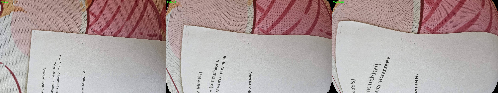

# Day 3 — Lens Distortion

Apply artificial **radial (barrel) distortion** to photos and correct it using OpenCV.

The script generates a side-by-side comparison of three images:

**Original | Distorted | Undistorted**

## Result



*Left to right: Original image, distorted image (barrel distortion), and corrected image.*

## What This Demonstrates

- Radial distortion coefficients: `k1`, `k2`, and `k3`.
- Tangential distortion coefficients: `p1` and `p2`.
- Barrel distortion using a negative `k1` coefficient.
- Approximate artificial distortion using an inverse remapping approach.
- Lens distortion correction with `cv2.undistort()`.
- Visual comparison of straight lines before and after distortion correction.

## Distortion Model (OpenCV)

OpenCV represents the distortion coefficients in the following order:

```text
dist = [k1, k2, p1, p2, k3]
```

The coefficients used in this project are:

```python
DIST_COEFFS = [-0.3, 0.1, 0.0, 0.0, 0.0]
```

Here, `k1 = -0.3` introduces barrel distortion, while `k2 = 0.1` adjusts the radial distortion further.

### Types of Radial Distortion

- **Barrel distortion:** Straight lines appear to curve outward from the image center. This is typically associated with a negative `k1` coefficient.
- **Pincushion distortion:** Straight lines appear to curve inward toward the image center. This is typically associated with a positive `k1` coefficient.

The exact visual effect depends on the complete set of distortion coefficients and the camera model.

## Processing Pipeline

```text
Original image
      |
      v
Create inverse remapping maps
      |
      v
Apply cv2.remap()
      |
      v
Image with approximate barrel distortion
      |
      v
Correct using cv2.undistort()
      |
      v
Create side-by-side comparison
      |
      v
Original | Distorted | Undistorted
```

### Implementation Note

Artificial distortion is approximated by applying an inverse undistortion mapping to a clean image. The resulting image is then corrected using `cv2.undistort()`.

Because the initial distortion is generated through inverse remapping, the corrected image should be close to the original, but it may not be pixel-perfect.

This project is an educational demonstration of lens distortion and correction. Generating distortion through a complete forward camera model requires a different mapping approach.

## How to Run

### 1. Navigate to the Project Directory

From the repository root:

```bash
cd week1_camera_models/day3_distortion
```

### 2. Create a Virtual Environment (Optional)

```bash
python -m venv venv
```

Activate it on Windows:

```powershell
venv\Scripts\Activate.ps1
```

On macOS or Linux:

```bash
source venv/bin/activate
```

### 3. Install Dependencies

```bash
pip install numpy opencv-python
```

### 4. Add Input Images

Place your photos in the `images/` directory.

Supported formats include `.jpg`, `.jpeg`, and `.png`.

### 5. Run the Script

```bash
python main.py
```

### 6. View the Results

- The script processes the available input images.
- Press any key in the OpenCV window to proceed to the next image.
- Generated images are saved in the `results/` directory.

## Project Structure

```text
day3_distortion/
├── main.py
├── images/
│   ├── 1.jpg
│   ├── 2.jpg
│   └── 3.jpg
├── results/
│   ├── 1_original.jpg
│   ├── 1_distorted.jpg
│   ├── 1_undistorted.jpg
│   └── 1_comparison.jpg
└── README.md
```

The example filenames above illustrate the expected structure. The actual number of output files depends on the input images processed.

## Technologies Used

- Python
- NumPy
- OpenCV

## Learning Objectives

By completing this project, I learned how radial lens distortion affects images, how distortion coefficients are represented in OpenCV, and how remapping and undistortion can be used to demonstrate and correct lens distortion.