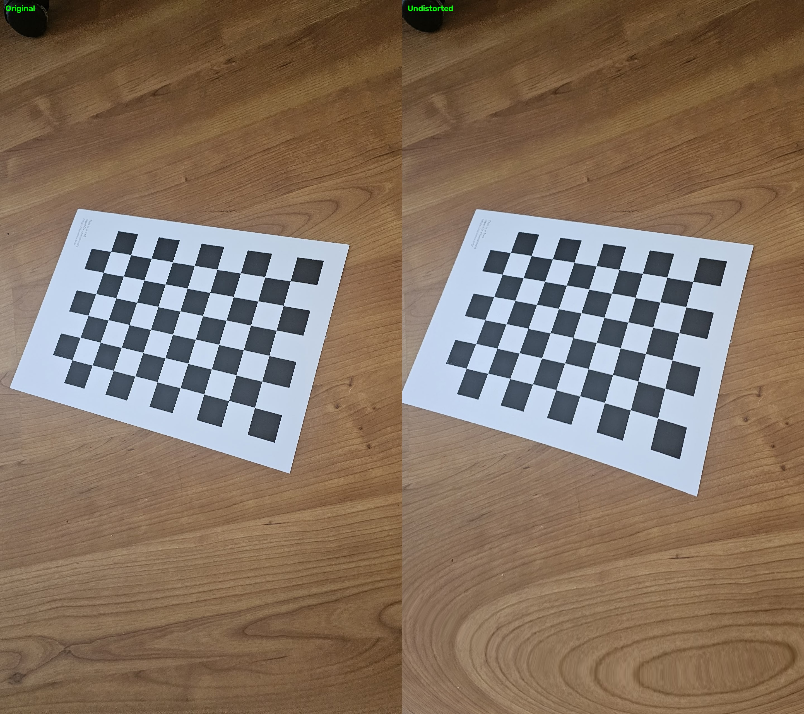
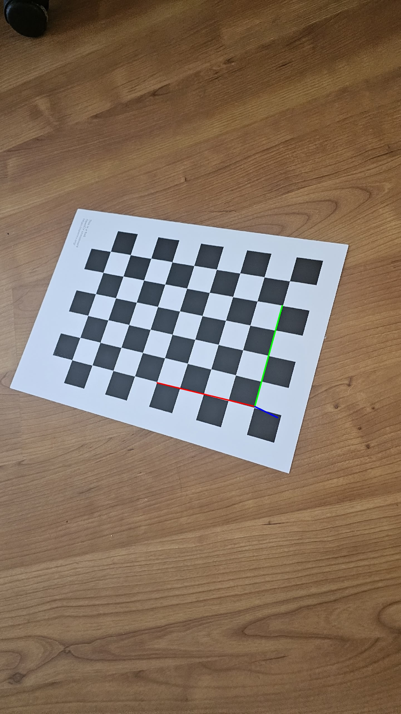

# Day 5 — Camera Calibration

Implement a complete camera calibration pipeline using a chessboard pattern, OpenCV, and NumPy.

The script detects chessboard corners, estimates the camera's intrinsic parameters and distortion coefficients, evaluates calibration accuracy, and generates visual results.

**Mean reprojection error: approximately 0.18–0.26 pixels**, depending on the input images and calibration results.

## Results

### Before vs. After Undistortion



*Comparison of the original image and the image after lens distortion correction.*

### Coordinate Axes Visualization



*3D coordinate axes visualized on the chessboard using the estimated camera parameters and pose.*

## What This Demonstrates

- Chessboard corner detection and sub-pixel refinement.
- Camera calibration using `cv2.calibrateCamera()`.
- Estimation of the intrinsic camera matrix `K` and distortion coefficients `dist`.
- Calculation of mean and per-image reprojection errors.
- Lens distortion correction using `cv2.undistort()`.
- Camera pose visualization using `cv2.drawFrameAxes()`.
- Saving calibration parameters to `camera_calibration.npz` for reuse.

## Calibration Pipeline

```text
calibration_images/
        |
        v
findChessboardCorners()
        |
        v
cornerSubPix()
        |
        v
calibrateCamera()
        |
        v
K, dist, rvecs, tvecs
        |
        v
Calculate reprojection errors
        |
        +----------------------------+
        |             |              |
        v             v              v
   Save camera    Generate        Visualize
   parameters     comparisons     coordinate axes
        |             |              |
        v             v              v
camera_        comparison_*.jpg  axes_visualization.jpg
calibration.npz
```

## Chessboard Settings

```python
CHESSBOARD_SIZE = (9, 6)  # Number of internal corners: columns x rows
SQUARE_SIZE = 0.025       # Square size in meters (2.5 cm)
```

**Important:** `CHESSBOARD_SIZE` specifies the number of internal corners, not the number of squares.

For example, a chessboard with **10 × 7 squares** has **9 × 6 internal corners**.

The `SQUARE_SIZE` value must match the actual size of one square on the physical chessboard.

## How to Run

### 1. Navigate to the Project Directory

From the repository root:

```bash
cd week1_camera_models/day5_calibration
```

### 2. Create a Virtual Environment (Optional)

```bash
python -m venv venv
```

Activate it on Windows:

```powershell
venv\Scripts\Activate.ps1
```

On macOS or Linux:

```bash
source venv/bin/activate
```

### 3. Install Dependencies

```bash
pip install numpy opencv-python
```

### 4. Add Calibration Images

Place your chessboard photos in the `calibration_images/` directory.

For better calibration results:
- Capture approximately 10–20 images.
- Use different chessboard angles and distances.
- Keep the entire chessboard visible.
- Ensure the corners are sharp and clearly distinguishable.

### 5. Run the Script

```bash
python main.py
```

The script processes the calibration images, estimates the camera parameters, calculates reprojection errors, and saves the results in the `results/` directory.

## Project Structure

```text
day5_calibration/
├── main.py
├── calibration_images/
│   ├── img01.jpg
│   ├── img02.jpg
│   └── ...
├── results/
│   ├── camera_calibration.npz
│   ├── corners_img01.jpg
│   ├── comparison_1.jpg
│   ├── axes_visualization.jpg
│   └── ...
└── README.md
```

*The filenames shown above are examples. Actual output filenames depend on the implementation and the input images.*

## Outputs

| File | Description |
|---|---|
| `camera_calibration.npz` | Saved camera matrix, distortion coefficients, calibration errors, and other parameters included by the script. |
| `corners_*.jpg` | Calibration images with detected chessboard corners. |
| `comparison_*.jpg` | Original and undistorted image comparisons. |
| `axes_visualization.jpg` | Visualization of 3D coordinate axes on the chessboard. |

## Loading Saved Calibration Parameters

The saved camera parameters can be loaded and reused without running the calibration process again.

```python
import numpy as np

data = np.load("results/camera_calibration.npz")

K = data["K"]
dist = data["dist"]

print("Camera matrix:")
print(K)

print("Distortion coefficients:")
print(dist)
```

The intrinsic matrix `K` describes the camera's focal lengths and principal point. The distortion coefficients `dist` describe the lens distortion estimated during calibration.

## Calibration Capture Tips

- Real smartphone photos can be used; a professional camera or studio is not required.
- Capture 10–20 images with varied angles, orientations, and distances.
- Keep the entire chessboard visible in each image.
- Avoid motion blur, poor focus, and strong reflections.
- Ensure the chessboard occupies different positions within the frame.
- Use a consistent, accurately measured square size.

## Why It Matters

Camera calibration estimates the parameters needed to interpret images more accurately.

The resulting camera matrix and distortion coefficients provide a foundation for:

- Lens distortion correction.
- Camera pose estimation.
- Structure from Motion (SfM).
- Augmented Reality (AR).
- 3D reconstruction and photogrammetry.
- Metric measurements from images.

## Technologies Used

- Python
- NumPy
- OpenCV