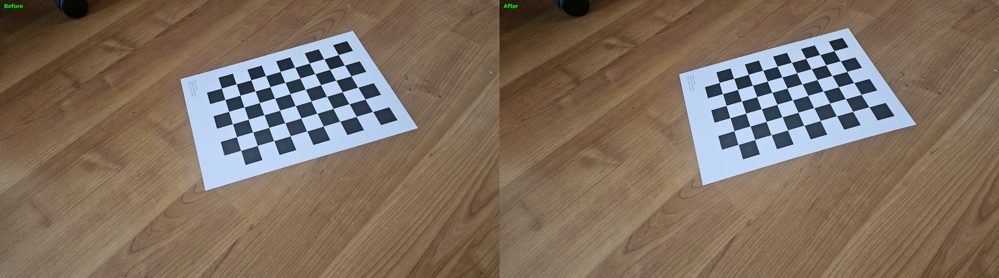
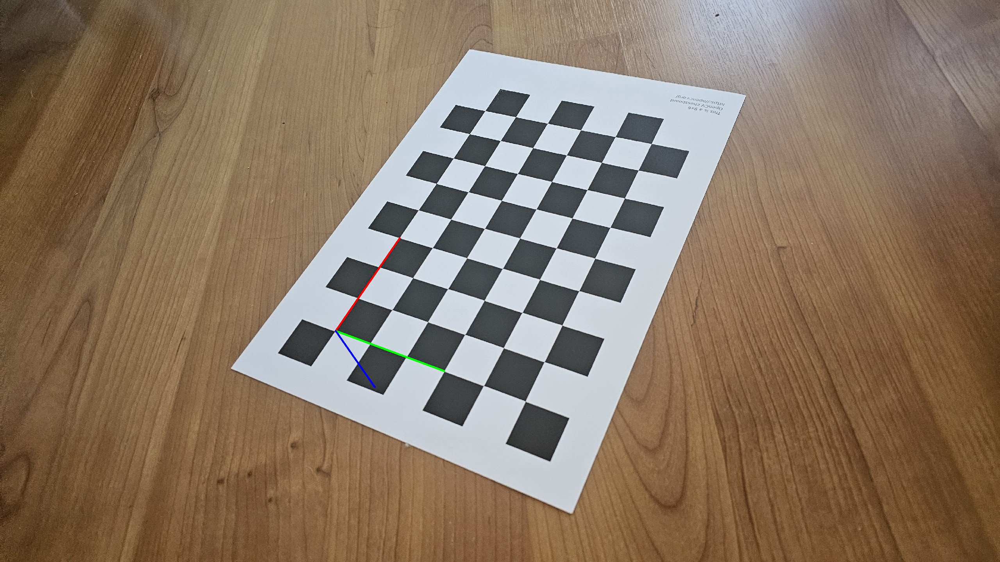

# Smartphone Camera Calibration

A practical computer vision project focused on smartphone camera calibration, lens distortion correction, and calibration quality analysis using Python, OpenCV, and NumPy.

The project consists of two complementary parts: a complete camera calibration pipeline using real smartphone photographs and a separate analysis of reprojection errors to evaluate and improve calibration quality.

The experiments use a physical chessboard pattern captured under uncontrolled indoor lighting, providing practical experience with camera geometry and real-world image data.

## Project Overview

Camera calibration estimates the intrinsic parameters of a camera and its lens distortion coefficients. These parameters can then be used to correct image distortion and support further computer vision applications.

This project explores the complete process, from detecting chessboard corners to evaluating calibration accuracy and testing the resulting parameters on ordinary photographs.

### Main Objectives

- Detect chessboard corners and refine their positions to sub-pixel accuracy.
- Estimate the camera intrinsic matrix and distortion coefficients.
- Calculate reprojection errors to evaluate calibration accuracy.
- Identify calibration images with unusually high reprojection errors.
- Compare calibration results before and after filtering problematic images.
- Apply the estimated parameters to image undistortion.
- Visualize 3D coordinate axes using the estimated camera parameters and pose.
- Save calibration parameters for reuse in subsequent computer vision projects.

## Projects

The repository contains two related projects.

### Project 1 — Full Camera Calibration

**Purpose:** Implement the complete smartphone camera calibration pipeline.

The first project uses chessboard images to estimate camera parameters and generate visual results. The calibration workflow includes corner detection, intrinsic parameter estimation, reprojection error calculation, image undistortion, and coordinate axes visualization.

**Key features:**
- Chessboard corner detection with OpenCV.
- Sub-pixel corner refinement.
- Camera calibration using `cv2.calibrateCamera()`.
- Estimation of the intrinsic camera matrix `K`.
- Estimation of radial and tangential distortion coefficients.
- Reprojection error evaluation.
- Original-versus-undistorted image comparisons.
- 3D coordinate axes visualization.
- Saving calibration parameters to a YAML file.

**Calibration setup:**

| Parameter | Value |
|---|---|
| Camera | Smartphone |
| Image resolution | 2528 × 1284 |
| Capture environment | Indoor lighting, no studio setup |
| Chessboard inner corners | 9 × 6 |
| Square size | 0.025 m |
| Calibration method | OpenCV camera calibration |

**Initial calibration result:** Mean reprojection error of approximately 1.43 pixels using 23 images.

**Project directory:** `apply_calibration/`

[View the full camera calibration README](./apply_calibration/README.md)


#### Visual Results

**Original vs. Undistorted Image**



*Comparison of an original photograph and its undistorted version.*

**Chessboard Corner Detection**


*Detected chessboard corners used during calibration.*

**3D Coordinate Axes Visualization**



*3D coordinate axes projected onto the chessboard.*

---

### Project 2 — Calibration Quality Analysis

**Purpose:** Evaluate calibration accuracy and investigate how selecting calibration images affects reprojection error.

The second project builds on the initial calibration results. It calculates reprojection errors for individual images, identifies the images with the highest errors, and compares the calibration metrics before and after filtering.

Four images with the highest initial reprojection errors were excluded from the final calibration.

**Key features:**
- Per-image reprojection error calculation.
- Identification of high-error calibration images.
- Comparison of initial and refined calibration results.
- Evaluation of mean reprojection error and RMS calibration error.
- Testing calibration parameters on ordinary photographs.
- Generation of visual comparisons for image undistortion.

**Project directory:** `quality_analysis/`

[View the calibration quality analysis README](./quality_analysis/README.md)

#### Calibration Quality Results

| Metric | Initial Calibration | Refined Calibration |
|---|---:|---:|
| Calibration images | 23 | 19 |
| Mean reprojection error | 1.43 px | 0.96 px |
| RMS calibration error | 1.97 px | 1.32 px |
| Images removed | 0 | 4 |

**Mean reprojection error improvement: 32.94%.**

The mean reprojection error decreased by 0.47 pixels after removing the four images with the highest errors.

The RMS calibration error also decreased, from 1.97 pixels to 1.32 pixels.

These results indicate an improvement in the calibration metrics for this dataset. However, a lower reprojection error does not automatically guarantee better undistortion for every photograph. Independent test images and visual inspection are also important when evaluating the final camera parameters.

#### Reprojection Error Analysis

The individual image errors were used to identify calibration observations that differed most from the projected chessboard points.

Images with high errors can be affected by several factors, including:
- Motion blur or poor focus.
- Difficult viewing angles.
- Inaccurate chessboard corner detection.
- Lighting conditions and image quality.
- Limited visibility of the calibration pattern.

A high reprojection error does not establish the exact cause of a problem. The images should also be inspected visually before deciding whether to exclude them.

#### Undistortion Testing

The final calibration parameters were tested on four ordinary photographs separate from the chessboard calibration images.

The quality analysis script generated the following comparisons:

- `comparison_1.jpg`
- `comparison_2.jpg`
- `comparison_3.jpg`
- `comparison_4.jpg`


*Example of an ordinary photograph tested using the estimated camera parameters.*

---

## Calibration Workflow

The two projects form a single workflow.

```text
Smartphone Chessboard Images
             |
             v
     Detect Chessboard Corners
             |
             v
      Refine Corner Positions
             |
             v
      Initial Calibration
       23 Images Used
             |
             v
   Calculate Reprojection Errors
             |
             v
    Identify High-Error Images
             |
             v
     Exclude 4 Images
             |
             v
      Final Calibration
       19 Images Used
             |
             v
   Compare Calibration Metrics
             |
             v
      Test Image Undistortion
             |
             v
   Save and Reuse Camera Parameters
```

## Technologies Used

| Technology | Purpose |
|---|---|
| Python | Implementation of the calibration pipeline |
| OpenCV | Chessboard detection, calibration, undistortion, and visualization |
| NumPy | Numerical operations and camera geometry |
| PyYAML | Reading and writing YAML calibration parameters |

## How to Run

Run each project independently from the `week2_camera_calibration` directory.

### 1. Install Dependencies

Install the required Python packages:

```bash
pip install opencv-python numpy pyyaml
```

### 2. Run Project 1 — Full Camera Calibration

Navigate to the project directory:

```powershell
cd apply_calibration
```

Run the script:

```powershell
python main.py
```

The script processes the calibration images and generates camera parameters and visual results.

### 3. Run Project 2 — Calibration Quality Analysis

Return to the parent directory:

```powershell
cd ..
```

Navigate to the quality analysis project:

```powershell
cd quality_analysis
```

Run the script:

```powershell
python main.py
```

The script analyzes reprojection errors and generates calibration quality results.

**Important:** Run each script from its own project directory so that relative paths to input images, configuration files, and output folders resolve correctly.

## Project Structure

```text
week2_camera_calibration/
│
├── apply_calibration/
│   ├── calibration_images/
│   ├── results/
│   ├── test_images/
│   ├── main.py
│   └── README.md
│
├── quality_analysis/
│   ├── calibration_images/
│   ├── results/
│   ├── test_images/
│   ├── camera_params.yaml
│   ├── main.py
│   └── README.md
│
└── README.md
```

### Directory Descriptions

- `apply_calibration/` — complete camera calibration pipeline.
- `quality_analysis/` — per-image reprojection error analysis and calibration quality evaluation.
- `calibration_images/` — chessboard photographs used for calibration.
- `test_images/` — ordinary photographs used to test calibration and undistortion.
- `results/` — generated visualizations, calibration outputs, and comparison images.
- `camera_params.yaml` — saved calibration parameters used by the quality analysis project.
- `main.py` — the entry-point script for each project.
- `README.md` — project-specific documentation.

The structure above illustrates the intended organization. Actual filenames and output folders may differ depending on the implementation.

## Key Findings

The experiments demonstrate several important aspects of practical camera calibration.

**1. Calibration depends on the quality of the input images.**

Different viewpoints provide useful geometric information, while blurred or difficult-to-detect chessboard corners can increase reprojection error.

**2. Per-image error analysis helps identify problematic observations.**

Calculating reprojection errors separately makes it possible to investigate individual calibration images rather than relying only on a single aggregate metric.

**3. Filtering images improved the calibration metrics in this experiment.**

After removing four high-error images, the mean reprojection error decreased from 1.43 pixels to 0.96 pixels.

**4. Calibration should also be evaluated visually.**

Reprojection error measures the consistency between observed image points and their projected positions. It does not, by itself, prove that the resulting distortion correction is optimal for every scene.

**5. Saved camera parameters can support later projects.**

The intrinsic matrix and distortion coefficients can be reused in image correction and other computer vision workflows without repeating the calibration process, provided the camera configuration and image geometry remain compatible.

## What I Learned

Through these projects, I gained practical experience with:

- Camera calibration using a physical chessboard.
- Chessboard corner detection and sub-pixel refinement.
- Camera intrinsic matrix estimation.
- Radial and tangential lens distortion.
- Reprojection error calculation and interpretation.
- Per-image calibration quality analysis.
- Selecting and evaluating calibration images.
- Image undistortion using OpenCV.
- Visualizing 3D coordinate axes on an image.
- Saving and reusing camera calibration parameters.
- Validating numerical results with visual experiments.

## Conclusion

This project demonstrates a practical smartphone camera calibration workflow, from estimating camera parameters to analyzing calibration quality and testing image undistortion.

By analyzing individual reprojection errors and excluding four high-error images, the mean reprojection error decreased from **1.43 px to 0.96 px**, representing an improvement of approximately **32.94%** for this dataset.

The two projects together provide a foundation for further work in camera pose estimation, photogrammetry, 3D reconstruction, and other 3D computer vision applications.