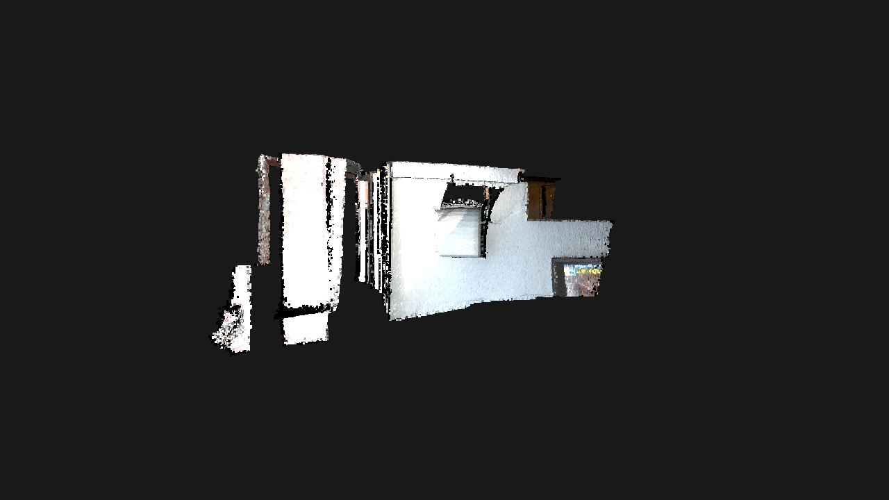
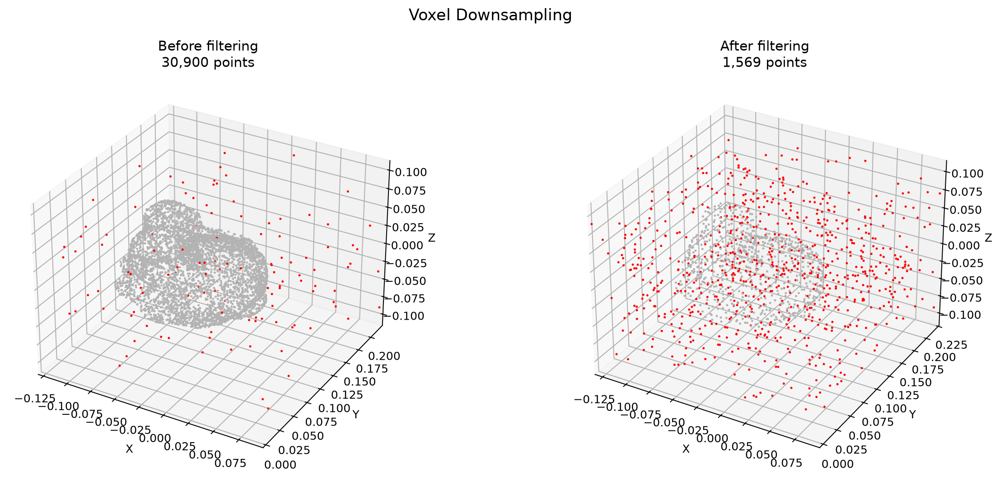
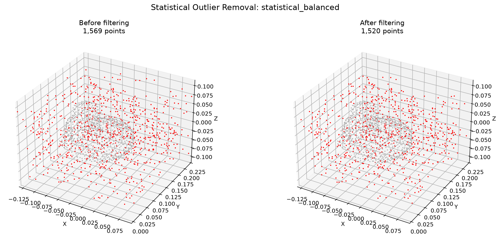
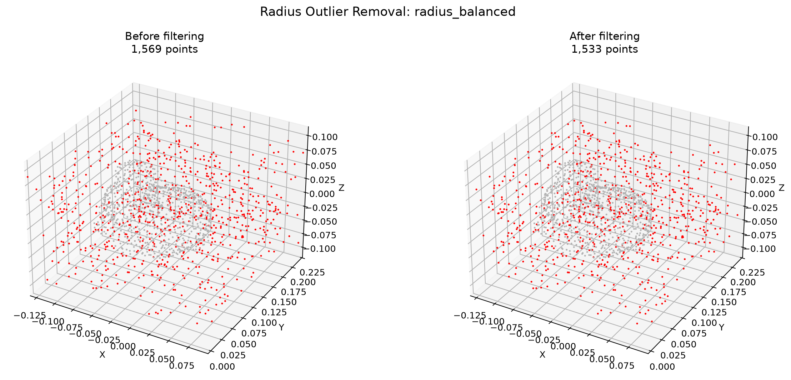
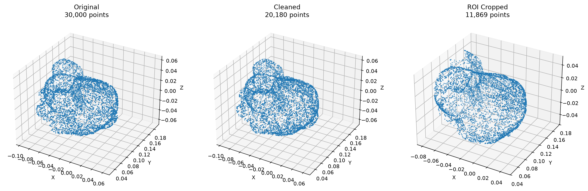
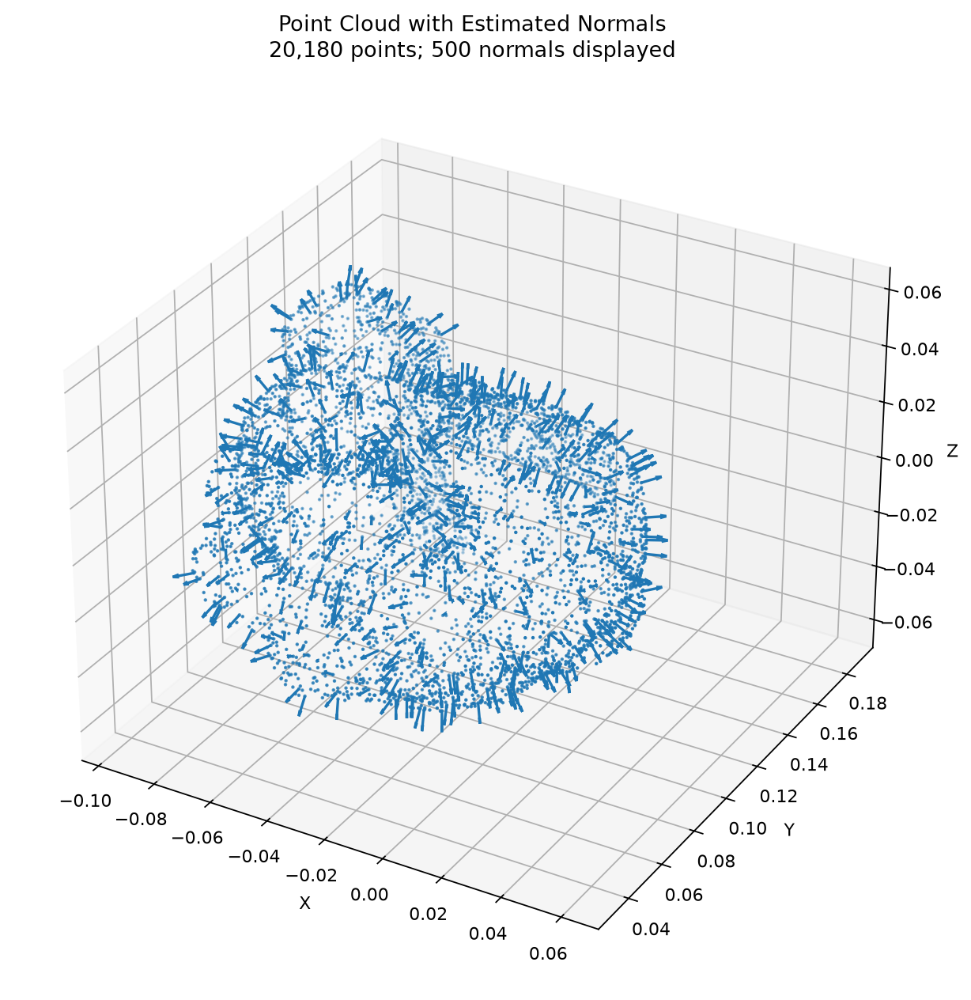
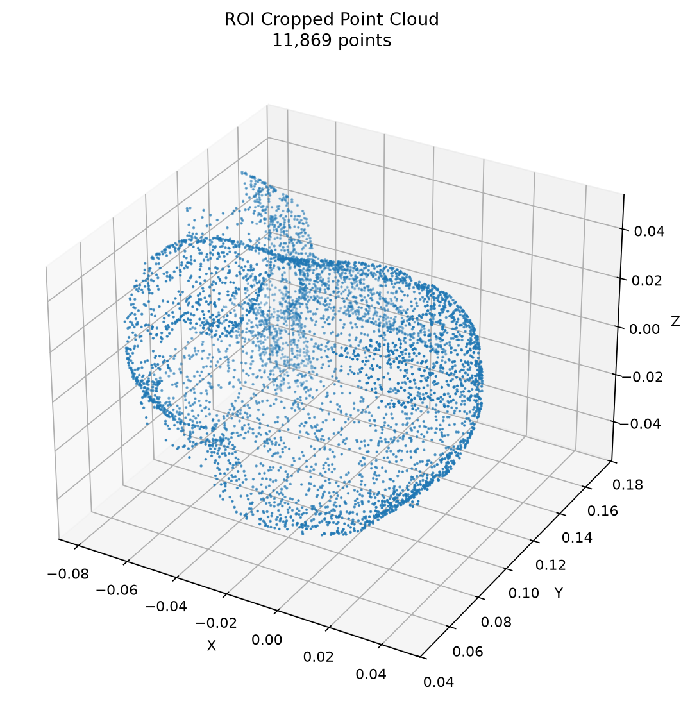

# Week 3 — Point Cloud Processing with Open3D

Practical 3D point cloud exercises covering visualization, filtering parameter studies, surface normal estimation, and Region of Interest (ROI) cropping.

This week builds on camera geometry and calibration (Weeks 1–2) and introduces **3D point cloud preprocessing** — an essential foundation for point cloud registration, Point-to-Plane ICP, mesh reconstruction, 3D Gaussian Splatting, and Scan-to-BIM workflows.

**Dataset:** Stanford Bunny  
**Technologies:** Python, Open3D, NumPy, Matplotlib

---

## Project Structure

```text
week3/
├── README.md
├── day1_pointcloud_basics.py
├── day2_filtering.py
├── day3_normals_and_roi.py
├── data/
└── results/
    ├── before.png
    ├── downsampled.png
    ├── cleaned.png
    ├── voxel_comparison.png
    ├── experiment_summary.txt
    ├── statistical/
    ├── radius/
    ├── 01_original.png
    ├── 05_pipeline_comparison.png
    ├── day3_summary.txt
    ├── cleaned/
    ├── with_normals/
    └── cropped/
```

The `results/` directory contains visualizations, filtered point clouds, normal estimation results, ROI crops, and experiment summaries generated by the scripts.

---

## Requirements

- Python 3.10–3.12 recommended
- Open3D
- NumPy
- Matplotlib

Install the dependencies:

```bash
python -m pip install open3d numpy matplotlib
```

If the repository has a root-level `requirements.txt`, you can also install the project dependencies from the repository root:

```bash
python -m pip install -r requirements.txt
```

## How to Run

Run the scripts from the Week 3 directory:

```bash
cd week3

python day1_pointcloud_basics.py
python day2_filtering.py
python day3_normals_and_roi.py
```

If the `data/` directory does not contain a supported point cloud file, the scripts can use the Stanford Bunny model provided by Open3D, provided the corresponding fallback is implemented and an internet connection is available for the initial download.

---

## Weekly Overview

| Day | Focus | Main Outcome |
|---|---|---|
| Day 1 | Point cloud basics | Load, inspect, and visualize a 3D point cloud |
| Day 2 | Filtering parameter study | Compare Statistical and Radius Outlier Removal configurations |
| Day 3 | Normals and ROI pipeline | Process a cloud from 30,000 to 11,869 points |

**Learning progression:**

- **Day 1:** Understand and visualize point cloud geometry.
- **Day 2:** Compare filtering methods and choose parameters based on experiments.
- **Day 3:** Reuse the selected filtering configuration in a pipeline with normal estimation and ROI cropping.

---

# Day 1 — Point Cloud Basics

## Goal

Load a 3D point cloud, inspect its properties, and visualize its geometry using Open3D.

## Dataset

**Stanford Bunny**

The Stanford Bunny is a commonly used 3D model for experimenting with geometry processing, visualization, and point cloud algorithms.

A point cloud represents an object's surface as a collection of points in three-dimensional space. Each point has XYZ coordinates and may also contain color or other attributes.

## Implementation

Script: `day1_pointcloud_basics.py`

Run:

```bash
python day1_pointcloud_basics.py
```

The script loads the point cloud, inspects its basic properties, and displays the geometry using Open3D.

## Results

**Point cloud visualization**



| Property | Value |
|---|---|
| Dataset | Stanford Bunny |
| Representation | 3D point cloud |
| Coordinates | XYZ |
| Visualization library | Open3D |

## What I Learned

- How point clouds represent 3D object geometry.
- How to load and visualize point clouds with Open3D.
- How XYZ coordinates describe spatial positions.
- How to inspect point counts and spatial bounds.
- Why visualization is an essential first step in 3D data processing.

---

# Day 2 — Point Cloud Filtering and Parameter Study

## Goal

Compare voxel downsampling, Statistical Outlier Removal (SOR), and Radius Outlier Removal (ROR) under different parameter settings.

The objective is to understand how each method affects point density, outlier removal, and geometry preservation, then select a suitable configuration for the Day 3 pipeline.

## Dataset and Experimental Setup

- **Base dataset:** Stanford Bunny
- **Input size:** 30,000 points
- **Synthetic noise:** 3% outliers
- **Voxel size:** `0.01`
- **Points after voxel downsampling:** 1,569

Synthetic outliers provide a controlled way to evaluate filtering behavior. Using the same input across experiments makes parameter comparisons more meaningful.

## Run the Experiment

```bash
python day2_filtering.py
```

The script runs multiple configurations, saves comparison visualizations, and writes an experiment summary.

## 1. Voxel Downsampling

Voxel downsampling divides 3D space into small cubic cells and represents the points in each occupied cell with a reduced set of points.

This reduces computational cost while preserving the overall shape of the object.

| Stage | Number of Points |
|---|---:|
| Input cloud with synthetic noise | 30,000 |
| After voxel downsampling (`voxel_size = 0.01`) | 1,569 |



The reduction from 30,000 to 1,569 points is primarily a change in sampling density, not evidence that the removed points were all noise.

## 2. Statistical Outlier Removal

Statistical Outlier Removal identifies points whose average distances to their nearest neighbors are unusually large compared with the overall distribution.

The method uses two main parameters:

- `nb_neighbors`: number of neighboring points used to estimate local distances.
- `std_ratio`: threshold controlling how far a point's average distance can deviate from the global mean.

The experiments below operate on the downsampled cloud of 1,569 points.

| Experiment | `nb_neighbors` | `std_ratio` | Before | After | Removed |
|---|---:|---:|---:|---:|---:|
| Conservative | 20 | 3.0 | 1,569 | 1,565 | 0.25% |
| **Balanced** | **20** | **2.0** | **1,569** | **1,520** | **3.12%** |
| Aggressive | 20 | 1.0 | 1,569 | 1,257 | 19.89% |
| Fewer neighbors | 10 | 2.0 | 1,569 | 1,517 | 3.31% |
| More neighbors | 40 | 2.0 | 1,569 | 1,507 | 3.95% |



### Interpretation

- `std_ratio = 3.0` is conservative and removes relatively few points.
- `std_ratio = 2.0` provides a moderate level of filtering.
- `std_ratio = 1.0` is much more aggressive and removes approximately 19.89% of the downsampled cloud.
- Changing the neighbor count also affects the filtering result.

Removing more points does not necessarily mean better cleaning. Aggressive filtering may remove valid surface points and damage the geometry.

## 3. Radius Outlier Removal

Radius Outlier Removal examines how many neighboring points fall within a specified radius. Points with insufficient local support are classified as outliers.

The main parameters are:

- `nb_points`: minimum number of neighbors required.
- `radius`: radius used to search for neighboring points.

| Experiment | `nb_points` | `radius` | Before | After | Removed |
|---|---:|---:|---:|---:|---:|
| Conservative | 8 | 0.05 | 1,569 | 1,567 | 0.13% |
| Balanced | 16 | 0.05 | 1,569 | 1,533 | 2.29% |
| Aggressive | 24 | 0.05 | 1,569 | 1,435 | 8.54% |
| Small radius | 16 | 0.025 | 1,569 | 871 | 44.49% |
| Large radius | 16 | 0.10 | 1,569 | 1,569 | 0.00% |



### Interpretation

- Increasing the minimum neighbor count can make filtering more aggressive.
- A radius that is too small can reject valid points because their local neighborhoods contain too few points.
- A radius that is too large may retain almost all points.
- Appropriate settings depend on the scale and sampling density of the input cloud.

## 4. Selected Configuration

**Selected Statistical Outlier Removal configuration:**

```python
nb_neighbors = 20
std_ratio = 2.0
```

This balanced configuration was selected for reuse in the Day 3 pipeline.

### Why this configuration?

| Reason | Explanation |
|---|---|
| Moderate filtering | Removes some outliers without the aggressive reduction observed with `std_ratio = 1.0` |
| Geometry preservation | Less aggressive than the configuration that removes approximately 19.89% of the downsampled cloud |
| Reusability | Provides a practical starting point for a subsequent preprocessing pipeline |

The Radius Outlier Removal step in Day 3 uses `nb_points = 8` with a radius scaled to the point cloud's bounding-box diagonal. Its effect depends on that radius and the local point density.

**Important:** the Day 2 radius experiments use a voxel size of `0.01` and radii of `0.025`, `0.05`, and `0.10`. Day 3 calculates its voxel size and radius relative to the cloud's bounding-box diagonal. These are different parameter scales, so the numerical values should not be compared directly.

## 5. Statistical vs. Radius Outlier Removal

| Characteristic | Statistical Outlier Removal | Radius Outlier Removal |
|---|---|---|
| Principle | Evaluates average distances to neighboring points | Counts neighbors within a fixed radius |
| Main parameters | `nb_neighbors`, `std_ratio` | `nb_points`, `radius` |
| Useful for | Detecting points with unusually large neighbor distances | Removing isolated points with insufficient local support |
| Main limitation | May affect valid points in regions with different sampling densities | Sensitive to the radius and local point density |

Both methods can improve point cloud quality, but neither guarantees perfect noise removal.

## Experiment Summary

The experiment output is saved to:

```text
results/experiment_summary.txt
```

The summary provides a record of the tested configurations and their results.

## What I Learned

- How voxel downsampling reduces point density.
- How Statistical Outlier Removal identifies points with unusual neighbor distances.
- How Radius Outlier Removal detects points with insufficient local support.
- Why parameter tuning matters in point cloud processing.
- How aggressive settings can remove useful geometric details.
- Why numerical results should be combined with visual inspection.
- How to select a practical filtering configuration for a reusable pipeline.

---

# Day 3 — Normals, ROI, and Cleaning Pipeline

## Goal

Build an end-to-end point cloud preprocessing pipeline by combining downsampling, outlier removal, surface normal estimation, and Region of Interest cropping.

The pipeline reuses the selected Statistical Outlier Removal configuration from Day 2.

## Pipeline

The script performs the following steps:

1. Load the Stanford Bunny point cloud.
2. Apply voxel downsampling.
3. Apply Statistical Outlier Removal.
4. Apply Radius Outlier Removal.
5. Estimate surface normals.
6. Crop the Region of Interest (ROI) using an axis-aligned bounding box.
7. Export processed point clouds, visualizations, and a summary.

## Run the Pipeline

```bash
python day3_normals_and_roi.py
```

The script saves its outputs in the `results/` directory.

## Parameters

The following values were recorded in `results/day3_summary.txt`.

| Operation | Parameter | Value |
|---|---|---:|
| Voxel downsampling | Voxel size | `0.00124996` |
| Statistical removal | `nb_neighbors` | `20` |
| Statistical removal | `std_ratio` | `2.0` |
| Radius removal | Minimum neighbors | `8` |
| Radius removal | Radius | `0.00374826` |
| Normal estimation | Search radius | `0.00749651` |
| Normal estimation | Maximum neighbors | `30` |
| ROI cropping | Minimum ratios | `(0.1, 0.1, 0.1)` |
| ROI cropping | Maximum ratios | `(0.9, 0.9, 0.9)` |

The voxel size, radius, and normal search radius are calculated relative to the cloud's bounding-box diagonal. This makes the pipeline more adaptable to point clouds of different scales than using the same absolute distances for every model.

## Point Count Results

The pipeline produced the following point counts:

| Processing Stage | Number of Points | Points Removed at This Stage |
|---|---:|---:|
| Original point cloud | 30,000 | — |
| After voxel downsampling | 20,893 | 9,107 |
| After Statistical Outlier Removal | 20,260 | 633 |
| After Radius Outlier Removal | 20,180 | 80 |
| **After ROI cropping** | **11,869** | **8,311** |

The final cloud contains **11,869 points**, down from the original 30,000 — a total reduction of approximately **60.44%**.

This reduction includes downsampling, outlier filtering, and ROI cropping. It must not be interpreted as a claim that 60.44% of the original points were noise.

## Pipeline Visualization



The comparison illustrates the changes between the original cloud, the cleaned cloud, and the cropped region of interest.

## Surface Normal Estimation

Surface normals describe the local orientation of a surface at each point.

They are useful for:

- **Point-to-Plane ICP:** computing alignment errors relative to local surface orientation.
- **Surface reconstruction:** supporting reconstruction methods that use normal information.
- **Geometry analysis:** examining local surface orientation and shape.
- **Visualization:** inspecting local geometric structure.

Normals are estimated using a hybrid KD-tree neighborhood search with a specified search radius and maximum number of neighbors.



After cropping, the normals can be re-estimated on the retained region to better reflect the local neighborhoods within that region.

## Region of Interest (ROI) Cropping

The pipeline uses an axis-aligned bounding box (AABB) to retain a central region of the point cloud.

The ROI is defined using the following ratios of the bounding-box extent:

- Minimum ratios: `(0.1, 0.1, 0.1)`
- Maximum ratios: `(0.9, 0.9, 0.9)`

This selects the central 80% of the bounding-box extent along each axis. It is a configurable geometric crop, not a semantic object detector.

### ROI Bounding Box

**Minimum bound:**

```text
[-0.07909207, 0.04872920, -0.04972257]
```

**Maximum bound:**

```text
[0.04540350, 0.17186362, 0.04672223]
```

These bounds define the selected ROI in the point cloud's coordinate system.

An AABB is simple and efficient for rectangular crops aligned with the coordinate axes. However, if an object is rotated, the box may retain unwanted points or exclude relevant geometry.

For real scans, ROI ratios or absolute bounds should be adjusted to match the region of interest.



## Pipeline Outputs

| Output | Description |
|---|---|
| `results/01_original.png` | Original point cloud |
| `results/cleaned/` | Point cloud after downsampling and outlier removal |
| `results/with_normals/03_normals.png` | Visualization of estimated surface normals |
| `results/cropped/04_roi.png` | Visualization of the cropped ROI |
| `results/05_pipeline_comparison.png` | Comparison of the original, cleaned, and cropped clouds |
| `results/day3_summary.txt` | Point counts, parameter values, and ROI bounds |

The `cleaned/`, `with_normals/`, and `cropped/` directories also contain the processed point cloud files exported by the script.

## Best Filter from Day 2 Reused in Day 3

Day 3 reuses the selected Statistical Outlier Removal configuration:

```python
nb_neighbors = 20
std_ratio = 2.0
```

It also applies a Radius Outlier Removal step with a minimum-neighbor threshold of `8` and a radius scaled to the cloud's size.

Using the selected statistical filter from Day 2 provides a consistent starting point for the cleaning pipeline. The radius filter then provides an additional opportunity to remove points with insufficient local support before normal estimation and ROI cropping.

The results depend on the point cloud's scale, density, and the selected radius. Parameter choices should be validated visually when the pipeline is applied to new datasets.

## What I Learned

- How to combine point cloud preprocessing operations into a single pipeline.
- How voxel downsampling reduces computational cost.
- How Statistical and Radius Outlier Removal complement each other.
- How to estimate surface normals using local neighborhoods.
- Why normals matter for registration and reconstruction.
- How to crop point clouds using an axis-aligned bounding box.
- How to export processed clouds, visualizations, and parameter summaries.
- Why point counts should be reported at each processing stage.

---

## Key Takeaways

1. **Inspect before processing.** Visualization helps reveal geometry and potential data issues.
2. **Tune parameters carefully.** Aggressive filtering can remove valid surface points.
3. **Use experiments to justify choices.** Day 2 compares configurations and provides a basis for the Day 3 filter selection.
4. **Combine complementary methods.** Statistical and Radius Outlier Removal identify potential outliers using different criteria.
5. **Estimate normals for geometry tasks.** Surface orientation is useful for registration and reconstruction.
6. **Use ROI cropping deliberately.** A geometric crop selects a region but does not identify semantic objects.
7. **Report every stage.** Point counts make data reduction interpretable.

## Next Steps

- Point cloud registration using ICP.
- Point-to-Point and Point-to-Plane ICP comparison.
- Multi-view point cloud alignment.
- Basic mesh reconstruction.
- Applying the pipeline to a real smartphone or LiDAR scan.