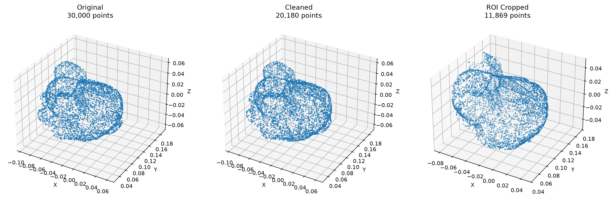
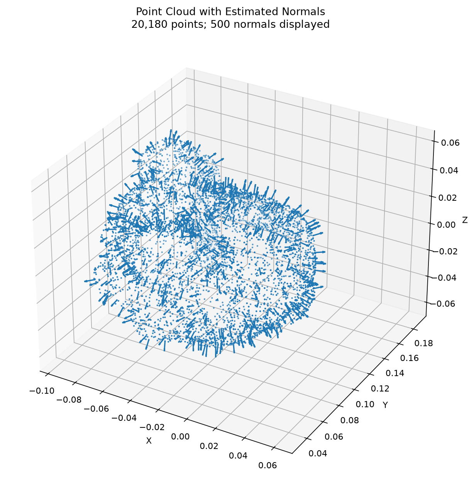
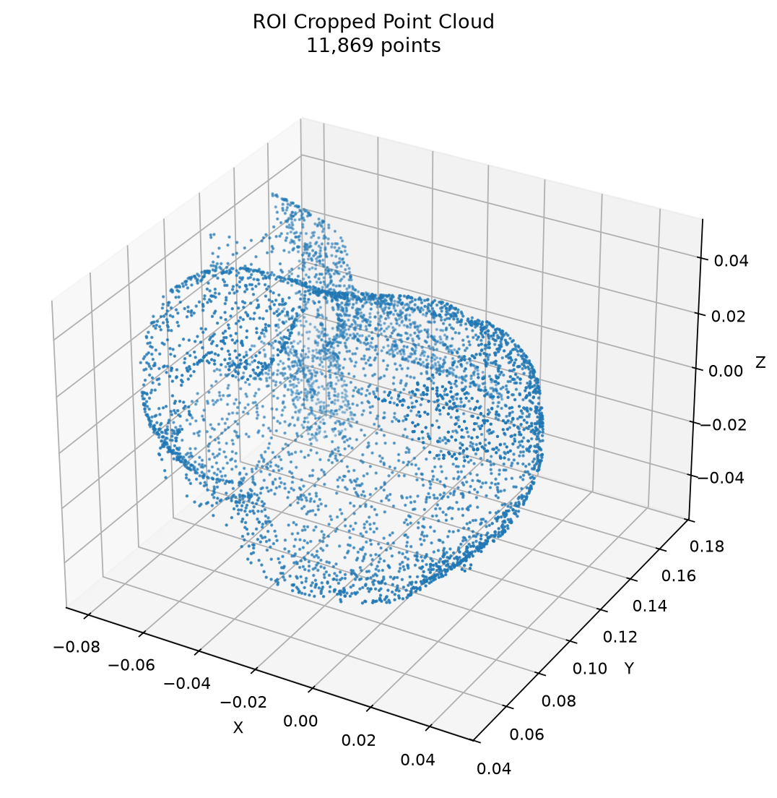

# Week 3 — Point Cloud Preprocessing with Open3D

Practical week on **3D point cloud preprocessing**: visualization, filtering parameter study, surface normals, ROI cropping, and a reusable cleaning pipeline.

The goal is to prepare point clouds for later tasks such as **ICP registration** and surface reconstruction (Week 4+).

**Stack:** Python, Open3D, NumPy, Matplotlib  
**Main dataset:** Stanford Bunny (Days 1–3); Day 4–5 also run on the available local / sample cloud used for the final pipeline audit

---

## Project structure

```text
week3_pointclouds/
├── data/
├── results/
│   ├── statistical/          # Day 2
│   ├── radius/               # Day 2
│   ├── comparison/           # Day 4
│   ├── cleaned/              # Day 3 / Day 5 outputs
│   ├── with_normals/
│   ├── cropped/
│   ├── visualizations/       # Day 5 screenshots (if present)
│   ├── experiment_summary.txt
│   ├── day3_summary.txt
│   ├── day6_audit_report.txt
│   └── 05_pipeline_comparison.png
├── day1_pointcloud_basics.py
├── day2_filtering.py
├── day3_normals_and_roi.py
├── day4_advanced_cleaning.py
├── day5_full_pipeline.py     # main reusable pipeline
├── day6.py                   # project audit / packaging
└── README.md
```

---

## Installation and how to run

```bash
pip install open3d numpy matplotlib
# or from repo root:
pip install -r requirements.txt

cd week3_pointclouds

python day1_pointcloud_basics.py
python day2_filtering.py
python day3_normals_and_roi.py
python day4_advanced_cleaning.py
python day5_full_pipeline.py      # preferred entry point
python day6.py                    # audit after Day 5 outputs exist
```

Place a `.ply` / `.pcd` file in `data/`, or rely on script fallbacks (Open3D sample / Bunny) where implemented.

---

## Week overview

| Focus                    | Script                    | Outcome                               |
| ------------------------ | ------------------------- | ------------------------------------- |
| Basics                   | `day1_pointcloud_basics.py` | Load and visualize a point cloud    |
| Parameter study          | `day2_filtering.py`         | Compare statistical vs radius filters |
| Pipeline + normals + ROI | `day3_normals_and_roi.py`   | Full clean → normals → crop           |
| Pipeline variants        | `day4_advanced_cleaning.py` | Three aggressiveness levels           |
| **Final pipeline**       | **`day5_full_pipeline.py`** | One-command reusable workflow       |
| Packaging                | `day6.py`                   | Structure / output audit              |

**Storyline:** Day 2 chooses parameters → Days 3–5 apply them in a full pipeline → Day 6 checks that outputs exist and are readable.

---

## Day 2 — Filtering parameter study (key experiment)

**Setup:** Stanford Bunny with **3% synthetic outliers**, then voxel downsampling.

| Stage                        | Points |
| ---------------------------- | -----: |
| Input (with synthetic noise) | 30,000 |
| After voxel size `0.01`      | **1,569** |

### Statistical Outlier Removal (on the downsampled cloud)

| Experiment   | nb_neighbors | std_ratio | Before | After | Removed |
| ------------ | -----------: | --------: | -----: | ----: | ------: |
| Conservative | 20 | 3.0 | 1,569 | 1,565 | 0.25% |
| **Balanced** | **20** | **2.0** | **1,569** | **1,520** | **3.12%** |
| Aggressive   | 20 | 1.0 | 1,569 | 1,257 | 19.89% |
| Neighbors 10 | 10 | 2.0 | 1,569 | 1,517 | 3.31% |
| Neighbors 40 | 40 | 2.0 | 1,569 | 1,507 | 3.95% |

### Radius Outlier Removal

| Experiment   | nb_points | radius | Before | After | Removed |
| ------------ | --------: | -----: | -----: | ----: | ------: |
| Conservative | 8  | 0.05  | 1,569 | 1,567 | 0.13% |
| Balanced     | 16 | 0.05  | 1,569 | 1,533 | 2.29% |
| Aggressive   | 24 | 0.05  | 1,569 | 1,435 | 8.54% |
| Small radius | 16 | 0.025 | 1,569 | 871   | 44.49% |
| Large radius | 16 | 0.10  | 1,569 | 1,569 | 0.00% |

Full log: `results/experiment_summary.txt`.

### Selected configuration

**Statistical filter:** `nb_neighbors=20`, `std_ratio=2.0` (balanced).

- Removes isolated noise without the heavy surface loss seen at `std_ratio=1.0` (~20% removed).
- `radius=0.025` is too aggressive (~45% removed on this scale).
- This setting is reused as the statistical stage in later pipelines.

**Takeaway:** more points removed ≠ better cleaning. Parameters must balance noise removal and geometry preservation.

---

## Day 3 — Normals, ROI, and cleaning pipeline

End-to-end pipeline on the **Stanford Bunny (30,000 points)** with parameters scaled relative to the bounding-box diagonal where applicable.

| Stage                       | Points | Δ |
| --------------------------- | -----: | -: |
| Original                    | 30,000 | — |
| After voxel downsampling    | 20,893 | −9,107 |
| After statistical filtering | 20,260 | −633 |
| After radius filtering      | 20,180 | −80 |
| **After ROI cropping**      | **11,869** | −8,311 |

Total reduction **≈ 60.4%** includes downsampling and ROI crop — **not** “60% noise removed”.

Parameters (from `results/day3_summary.txt`):

| Step        | Parameter                | Value |
| ----------- | ------------------------ | ----: |
| Voxel       | size (relative)          | ≈ 0.00125 |
| Statistical | nb_neighbors / std_ratio | 20 / 2.0 |
| Radius      | nb_points / radius       | 8 / ≈ 0.00375 |
| Normals     | search radius / max_nn   | ≈ 0.0075 / 30 |
| ROI         | min–max ratios           | 0.1–0.9 per axis |

### Results







Normals support later **point-to-plane ICP** and reconstruction. ROI here is an **axis-aligned demo crop** (central ~80% of the bbox), not semantic segmentation.

---

## Day 4 — Comparing full cleaning combinations

Three pipelines on a **noisy input** (~119,345 points), same stage order: voxel → statistical → radius.

| Pipeline | Voxel | Statistical | Radius | Final points | Retention |
| -------- | ----: | ----------- | ------ | -----------: | --------: |
| cleaned_v1 | 0.01 | 20 / 2.0 | 12 / 0.04 | 56,989 | **47.8%** |
| cleaned_v2 | 0.02 | 20 / 2.0 | 16 / 0.05 | 14,990 | 12.6% |
| cleaned_v3 | 0.03 | 30 / 1.0 | 20 / 0.07 | 5,214 | 4.4% |

Source: `results/comparison/cleaning_report.csv`.

v1 is mild; v3 is very aggressive. Final choice should follow **visual** inspection, not retention alone.

---

## Day 5 — Final reusable pipeline

Script: **`day5_full_pipeline.py`**

1. Load and validate point cloud
2. Voxel downsampling
3. Statistical outlier removal (`nb_neighbors=20`, `std_ratio=2.0`)
4. Optional radius outlier removal
5. Estimate normals (+ consistent tangent-plane orientation)
6. ROI crop (ratios 0.1–0.9)
7. Save PLY stages + summary + screenshots

**Audit snapshot** (Day 6, after a successful Day 5 run on the cloud used for packaging):

| Output | Points |
| ------ | -----: |
| Cleaned cloud | 767 |
| Cloud with normals | 767 (all valid) |
| Cropped ROI | 429 |

> **Note:** Day 5 packaging numbers above come from the cloud used in the final audit (smaller than the 30k Bunny run in Day 3). Day 3 remains the main **Bunny** quantitative reference (30,000 → 11,869). Always state which input a table refers to.

Typical outputs:

- `results/cleaned/cleaned_pointcloud.ply`
- `results/with_normals/pointcloud_with_normals.ply`
- `results/cropped/cropped_roi.ply`
- `results/visualizations/01_original.png` … `04_cropped_roi.png` (when screenshots succeed)
- `results/summaries/day5_pipeline_summary.txt`

---

## Day 6 — Audit

`day6.py` checks scripts, folders, final PLY readability, normals, and visualizations. Latest report: **20 checks passed, 0 failed** (`results/day6_audit_report.txt`).

This confirms **packaging completeness**, not registration quality. ICP is **not** implemented in Week 3.

---

## Key takeaways

1. Voxel downsampling controls density and cost before filtering.
2. Statistical and radius filters remove different kinds of outliers; parameters are scale-dependent.
3. A short **parameter study** (Day 2) justifies settings used in the full pipeline.
4. Normals and a clean cloud are prerequisites for point-to-plane ICP — not ICP itself.
5. ROI with an AABB is a simple spatial crop, not object detection.
6. Report **counts per stage** so reductions stay interpretable.

---

## Limitations

- Absolute voxel/radius values depend on cloud scale; retune for new data (or use relative sizing as in Day 3).
- Synthetic outliers (Day 2) are a controlled test, not a full real-scan noise model.
- Normal orientation may need extra checks on disconnected surfaces.
- Day 3 and Day 5 tables may refer to **different inputs** — see note above.

---

## Next

**Week 4 — ICP registration:** align source and target clouds (point-to-point and point-to-plane), using a cleaned cloud with normals from this week as a starting point.
