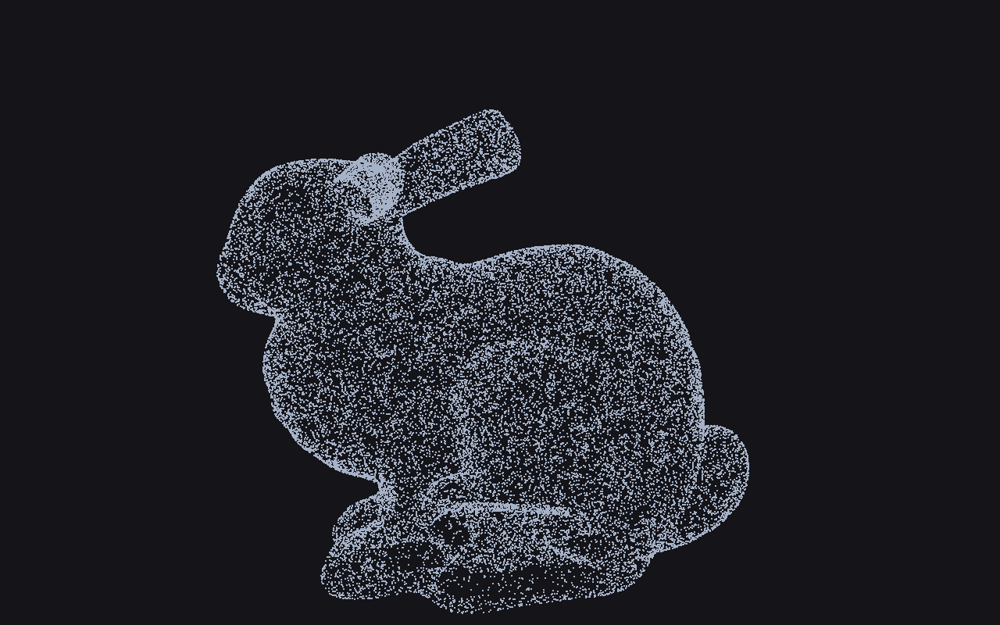
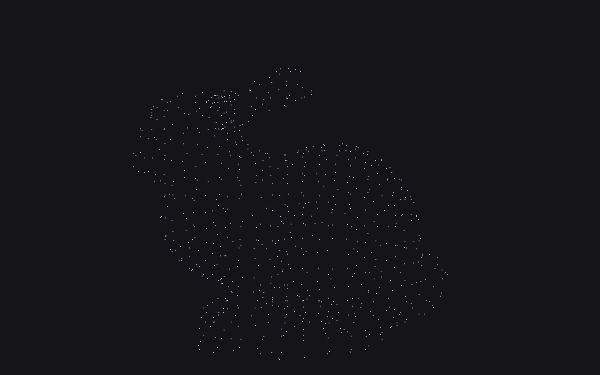
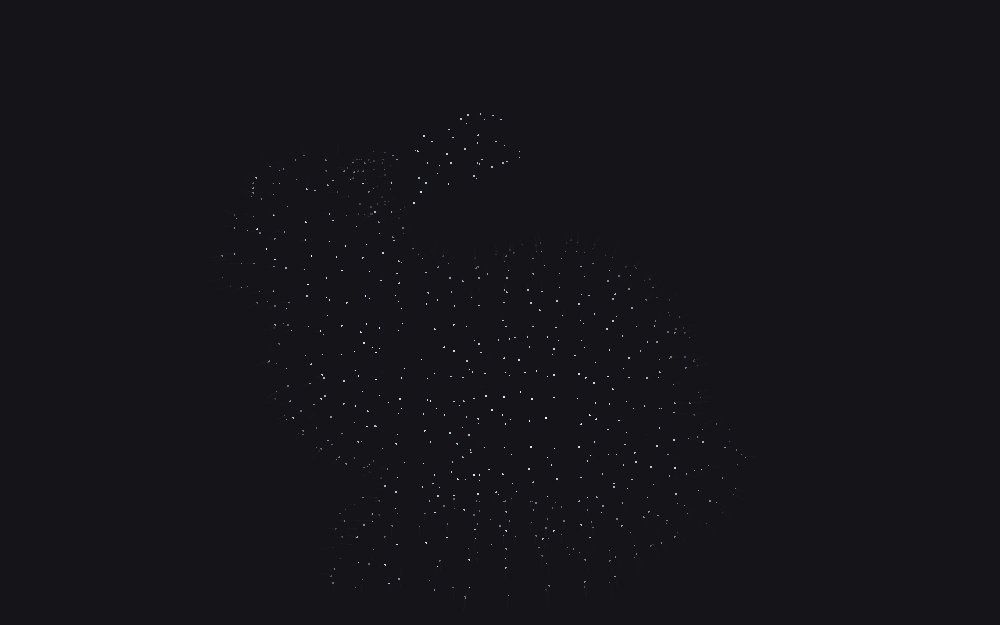
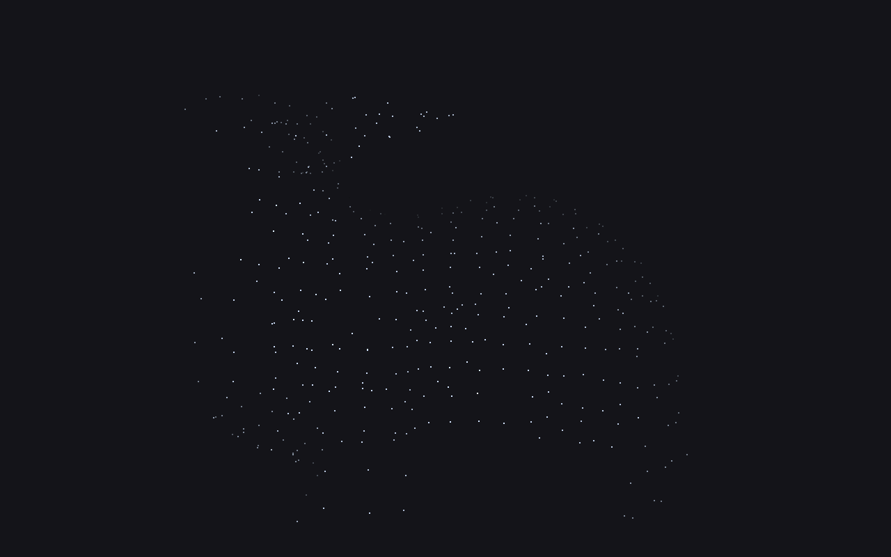

# Week 3 — Point Cloud Processing with Open3D

## Overview

A reusable point cloud preprocessing pipeline built with Python,
Open3D and NumPy.

This project explores point cloud loading, voxel downsampling,
outlier removal, normal estimation and region-of-interest (ROI)
cropping.

The goal is to prepare 3D data for subsequent workflows such as
ICP registration and surface reconstruction.

## Pipeline

1. Load and validate the input point cloud.
2. Reduce point density using voxel downsampling.
3. Remove statistical outliers.
4. Optionally remove radius-based outliers.
5. Estimate local surface normals.
6. Crop a region of interest using an axis-aligned bounding box.
7. Save intermediate and final point clouds.
8. Generate visualizations and a processing report.

## Project Structure

```text
week3_pointclouds/
├── data/
├── results/
│   ├── intermediate/
│   ├── cleaned/
│   ├── with_normals/
│   ├── cropped/
│   ├── visualizations/
│   ├── portfolio/
│   └── summaries/
├── day1_pointcloud_basics.py
├── day2_filtering.py
├── day3_normals_and_roi.py
├── day4_advanced_cleaning.py
├── day5_full_pipeline.py
└── README.md
```

`day5_full_pipeline.py` is the main reusable preprocessing script.

## Parameters

The following values are read from the Day 5 configuration.

| Operation | Parameter | Value |
|---|---|---|
| Voxel downsampling | voxel_size | 0.01 |
| Statistical filtering | nb_neighbors | 20 |
| Statistical filtering | std_ratio | 2.0 |
| Radius filtering | Configuration | nb_points=8, radius=0.025 |
| Normal estimation | radius | 0.075 |
| Normal estimation | max_nn | 30 |
| ROI cropping | Minimum ratio | 0.10 |
| ROI cropping | Maximum ratio | 0.90 |

These parameters are starting values for the selected dataset,
not universal optimal settings. Their effect should be evaluated
using point counts and visual inspection.

## Results

The pipeline saves the following outputs:

- `results/cleaned/cleaned_pointcloud.ply`
- `results/with_normals/pointcloud_with_normals.ply`
- `results/cropped/cropped_roi.ply`
- `results/summaries/day5_pipeline_summary.txt`

### Original Point Cloud



### Cleaned Point Cloud



### Point Cloud with Normals



### Cropped Region of Interest



Commit the corresponding PNG files to GitHub for these images
to appear in the README.

## Data

- Input file(s): Add the dataset name here
- Dataset source: Stanford Bunny dataset — verify exact source
- Dataset provenance: verify the exact source and licensing
  before publishing.

## How to Run

Install the dependencies:

```bash
python -m pip install open3d numpy
```

From the repository root, run:

```bash
python week3_pointclouds/day5_full_pipeline.py
```

Place a supported point cloud in the `data/` directory first.

To specify a particular input file:

```bash
python week3_pointclouds/day5_full_pipeline.py week3_pointclouds/data/bunny.ply
```

Replace `bunny.ply` with the actual filename.

## Key Concepts Learned

- Voxel downsampling reduces point density and computational cost.
- Statistical outlier removal identifies points with unusually
  large average distances to their neighbors.
- Radius outlier removal eliminates points with insufficient
  local neighborhood density.
- Normal estimation describes local surface orientation.
- ROI cropping selects a spatial region of a point cloud.
- A reproducible preprocessing pipeline makes downstream
  registration and reconstruction workflows easier to manage.

## Preparing for ICP Registration

The cleaned point cloud and its estimated normals provide useful
inputs for subsequent registration experiments.

ICP (Iterative Closest Point) estimates a transformation that
aligns corresponding geometric data between two point clouds.

Before running ICP, inspect both input clouds, ensure they use
compatible coordinate units, and evaluate whether an initial
alignment is needed.

Normal estimation alone does not align two point clouds.
Likewise, this preprocessing pipeline does not perform registration.

## Limitations

- ROI cropping uses an axis-aligned bounding box rather than
  semantic object detection.
- Filtering parameters depend on point density, noise and scale.
- Estimated normal directions may require additional orientation
  checks.
- Results must be visually inspected before downstream use.

## Future Work

- Prepare source and target point clouds for ICP.
- Compare point-to-point and point-to-plane registration.
- Evaluate registration accuracy and alignment quality.
- Explore mesh reconstruction from cleaned point clouds.
